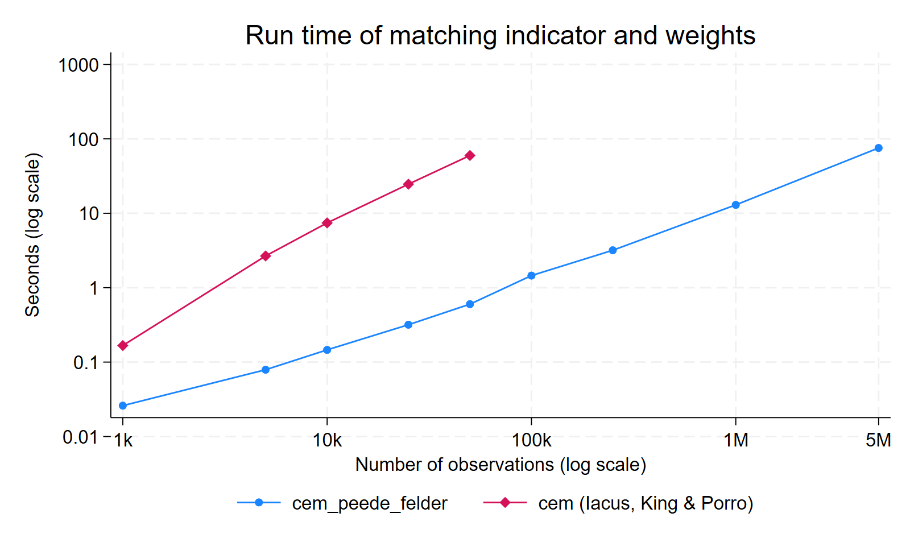

# Fast Coarsened Exact Matching for Large Datasets in Stata

> Replicates the matching indicator and weights of the Stata package `cem` (Blackwell et al. 2009; Iacus, King & Porro 2012) using a sort-based algorithm. On large administrative datasets with 1 million+ observations it needs seconds to minutes, where `cem` needs hours.

## Purpose

`cem_peede_felder` computes exactly the same match indicator and CEM weights as `cem`, so CEM becomes usable on large administrative data. It computes **only** these two outputs. The code is a do-file rather than an ado-file, so it can be transferred easily into research data centre (FDZ) environments.

## Usage example

```stata
do "cem_peede_felder_program.do"
cem_peede_felder x1 x2 x3, treat_indicator(treat) id(betnr) timevar(year) year(2015)
```

This creates two variables:

- `matched_cem`: 1 = matched, 0 = not matched (same as `cem_matched`)
- `weight_cem`: CEM weight, 0 if not matched (same as `cem_weights`)

Both are computed in the matching year and copied to all years of the same id.

## Requirements

- **Matching variables must be coarsened beforehand** (categorical). Continuous variables would be matched value by value.
- **`id`** uniquely identifies observations within the matching year.
- **Treatment** is coded 0/1, has no missings, and is fixed per id. All ids share one matching year.
- **Missing values** in matching variables count as their own category, as in `cem`.

The program stops with an error if the id or treatment requirements are violated.

## What it does not do

It does not coarsen variables or compute imbalance measures (L1). It also does not support k2k matching, multiply imputed data, more than two treatment groups, or different matching years per id. Use `cem` for these.

## Tests and benchmark

[`examples_speedtest/cem_peede_felder_tests.do`](examples_speedtest/cem_peede_felder_tests.do) compares the results with `cem` observation by observation on simulated data and times both commands. See below for the results.

## Authors

Lennert Peede and Lars Felder. If you spot mistakes or unexpected behaviour, please e-mail Lars Felder at lfelder@diw.de.


# Why `cem_peede_felder` is faster than `cem`

`cem_peede_felder` returns the same match indicator and CEM weights as `cem` (Blackwell et al. 2009; Iacus, King & Porro 2012). Part 1 of `cem_peede_felder_tests.do` checks that the two agree observation by observation. The difference is in how the results are computed:

- **`cem`** loops over the observations one at a time in Mata. Inside that loop it does work that grows with the size of the whole dataset. Its run time therefore grows roughly with **N²**.
- **`cem_peede_felder`** uses only a handful of Stata's built-in sort-based commands. Each of them grows with **N log N**, and there is no loop over observations.
- Cores: Stata/MP runs these sorts on several processor cores at once, while cem's loop processes one observation after another on a single core. On machines with more cores, the gap is therefore larger.

## Measured run times with example dataset

The data has one period, 6 matching variables with 4 categories each (4,096 possible cells) and 30% treated. The settings are Part 3 of `cem_peede_felder_tests.do`, run with Stata/MP 18.5 using 8 cores on a laptop with an Intel i3-1315U processor. Each time is a single run in seconds. `cem` was run with `noimbal`, so it computes matching and weights only, like `cem_peede_felder`.

| N | matched | `cem_peede_felder` | `cem` | `cem` / ours |
|---:|---:|---:|---:|---:|
| 1,000 | 112 | 0.03 | 0.17 | 6× |
| 5,000 | 2,014 | 0.08 | 2.7 | 34× |
| 10,000 | 6,116 | 0.15 | 7.4 | 51× |
| 25,000 | 22,007 | 0.32 | 24.6 | 77× |
| 50,000 | 49,115 | 0.60 | 59.8 | 99× |
| 100,000 | 99,926 | 1.5 | 192 ¹ | ~130× |
| 200,000 | – | 1.6 ¹ | 631 ¹ | ~400× |
| 1,000,000 | 1,000,000 | 13 | not run | |
| 5,000,000 | 5,000,000 | 75 | not run | |

¹ From a separate timing run on the same machine. Timings differ somewhat between runs because of machine load.

The ratio is not a fixed factor: it keeps growing with N. Doubling N roughly doubles the time of `cem_peede_felder`. For `cem`, doubling N from 100,000 to 200,000 multiplied the time by 3.3. Extending that trend gives several hours for `cem` at N = 1,000,000; this is an extrapolation, not a measurement. `cem_peede_felder` needs 13 seconds for that size.

With the default imbalance statistics (no `noimbal`), `cem` is slower still: 77 s instead of 57 s at N = 50,000 (in the separate timing run ¹).



## What `cem` does

The matching happens in the Mata function `assignStrata()` in `cem-mata.do`, which is part of the installed `cem` package. After coarsening, it works in four steps:

1. **Build a text key per observation.** The values of all matching variables are turned into strings and concatenated, e.g. `"2 1 4 3 1 2"`. This is a Mata loop over all N observations. It costs little.
2. **List the distinct strata.** `uniqrows()` sorts the keys and keeps the S distinct ones. It is fast, because it is a single sort.
3. **Loop over all N observations again**. For each observation *i*:
   - **a. Find its stratum number** with `lookup(xx[i], st)`. `lookup()` is a **linear search**: it compares the key with the list of strata one entry at a time until it finds a match. That is on average S/2 string comparisons, so the step costs **N × S** in total. (S = number of strata.)
   - **b. Update the table of counts per stratum and treatment group.**
   - **c. Mark the stratum as matched.** If the stratum now contains both treated and controls, it runs `matched = matched :+ (1:-matched):*(strata:==strata[i])`. This compares **all N** observations with the current stratum. It runs not once per stratum but for **every** observation in a stratum that is already matched, so it costs about **N × (number of matched observations)**. When a fixed share of observations is matched, that is **N²**.
4. **Compute the weights.** This is vectorised and cheap.

Profiling these steps separately on the benchmark data gives (seconds):

| N | strata S | 1. keys | 2. `uniqrows` | 3a. `lookup` | 3c. matched update |
|---:|---:|---:|---:|---:|---:|
| 10,000 | 3,769 | 0.04 | 0.01 | 2.2 | 0.5 |
| 25,000 | 4,086 | 0.10 | 0.01 | 13.5 | 8.1 |
| 50,000 | 4,096 | 0.54 | 0.07 | 32.6 | 28.9 |
| 100,000 | 4,096 | 1.12 | 0.19 | 64.6 | 97.7 |

Almost all the time goes into steps 3a and 3c:

- **3a (`lookup`)** grows with N × S. In this design S stops growing at 4,096, so from N = 50,000 on the step only doubles when N doubles. With more matching variables or categories, S keeps growing and so does this cost.
- **3c (matched update)** grows with N². From 50,000 to 100,000 it rises 3.4-fold, and it already dominates at N = 100,000.

Both steps also run inside an interpreted Mata loop, which is much slower per operation than Stata's built-in commands.

## What `cem_peede_felder` does

`cem_peede_felder` reaches the same result with built-in Stata commands only. Each command sorts or groups the data once, in compiled code:

1. `egen group(X treat)` numbers every combination of matching variables and treatment.
2. `bysort strata` marks the first observation of each of these groups.
3. `duplicates tag X` on these first observations: a cell of X appears twice exactly when it contains both treated and controls, i.e. when it is matched.
4. `bysort strata: egen max()` passes the matched flag to all observations of the group.
5. `egen group()` on the matched groups, followed by `ceil(strata2/2)`, recovers the cell of X. The control and treated groups of a matched cell are numbered consecutively.
6. `bysort ... egen total()` counts treated and controls per cell. The weights then follow from the CEM weight formula (Blackwell et al. 2009; Iacus, King & Porro 2012):

   w = (m_C / m_T) · (m_T^s / m_C^s) for controls, and w = 1 for treated.
7. `bysort id: egen max()` copies the results to all periods of a unit.

Each step is one sort, about N log N, plus one pass over the data. Nothing compares an observation with the whole list of strata, and nothing passes over all N observations once per observation. That is why the run time grows almost in proportion to N.

## What `cem_peede_felder` does not do

The comparison is fair only for the match indicator and the weights, but `cem` does more:

- **Coarsening:** `cem` can coarsen variables itself. `cem_peede_felder` expects variables that are already coarsened and categorical; the tests use `(#0)` so that `cem` matches exactly too.
- **Imbalance statistics:** `cem` computes the L1 distance and univariate imbalance measures, unless you specify `noimbal` as in this run time testing exercise.
- **Other options:** `cem` supports one-to-one matching (`k2k`), multiply imputed data and treatments with more than two groups.

## References

- Blackwell, Matthew, et al. "CEM: Coarsened exact matching in Stata." *The Stata Journal* 9.4 (2009): 524–546.
- Iacus, Stefano M., Gary King, and Giuseppe Porro. "Causal inference without balance checking: Coarsened exact matching." *Political Analysis* 20.1 (2012): 1–24.
